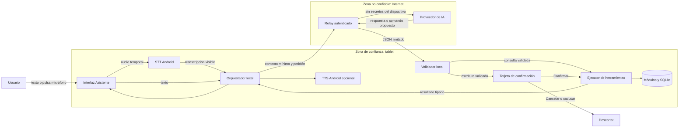

# ADR — Arquitectura segura del Asistente

> Estado: aceptado para el primer incremento de las issues #27 y #28.
>
> Fecha: 11/10/2026.
>
> Contrato funcional: [ASISTENTE-IA.md](ASISTENTE-IA.md).

## 1. Decisión

El Asistente tendrá una arquitectura **híbrida y con proveedor intercambiable**:

- la tablet conserva el estado y ejecuta todas las herramientas mediante los módulos actuales;
- un relay autenticado, separado del APK, contiene las credenciales y llama al proveedor remoto;
- el proveedor solo devuelve una respuesta o una propuesta de comando tipado;
- la tablet valida el esquema y las reglas de negocio, calcula si la acción requiere confirmación y solo entonces la ejecuta;
- voz a texto y texto a voz se resuelven en Android cuando estén disponibles, sin enviar audio al proveedor de lenguaje;
- sin red o sin proveedor se mantienen los módulos manuales y un conjunto local limitado de consultas y ayuda.

OpenAI Responses con `gpt-6-luna`, salida estructurada estricta y `store: false` será la primera integración de referencia. La interfaz no expone esa elección al resto de la aplicación y permite sustituirla por Gemini u otro proveedor. Ninguna clave del proveedor se incluye en el APK, JavaScript, preferencias, SQLite o logs.

## 2. Flujo de datos y límites de confianza

El relay recibe únicamente texto, idioma, zona horaria, catálogo de herramientas permitido y el fragmento mínimo de contexto necesario. No recibe la base completa, fotos, credenciales móviles, tokens de emparejamiento ni historial general. Debe aplicar autenticación de la instalación, límite de uso, tamaño máximo, tiempo de espera, lista de modelos permitidos y métricas sin contenido.

## 3. Contrato y ejecución

El contrato ejecutable está en `src/assistant/contracts.ts`; la abstracción del proveedor, en `src/assistant/provider.ts`. El catálogo inicial es:

| Herramienta | Tipo | Confirmación | Resultado esperado |
| --- | --- | --- | --- |
| `get_daily_summary` | lectura | no | agenda, alarmas y tiempo ya disponibles localmente |
| `get_weather` | lectura | no | previsión y fecha de actualización |
| `get_calendar` | lectura | no | eventos en un intervalo acotado |
| `create_note` | escritura | siempre | identificador de la nota creada |
| `create_alarm` | escritura | siempre | identificador y próxima activación |
| `start_timer` | escritura | siempre | identificador y hora final |
| `get_local_help` | lectura local | no | pasos versionados con la app |

Reglas obligatorias:

1. El modelo no indica de forma vinculante si una acción necesita confirmación; la aplicación lo deriva del tipo validado.
2. Se rechazan comandos desconocidos, campos extra, fechas inválidas, rangos inversos, textos vacíos y duraciones fuera de los límites.
3. En el MVP solo puede existir una propuesta de escritura visible y pendiente. Otra petición, cerrar la pantalla o cancelar la invalida.
4. La ejecución recibe un identificador de idempotencia generado por la app para evitar duplicados tras un reintento o pérdida de conexión.
5. Un fallo conserva el borrador visible, muestra una alternativa manual y no reintenta escrituras automáticamente.
6. Cancelar el dictado, la petición remota o la síntesis usa `AbortSignal` cuando corresponda y nunca deja una acción confirmada implícitamente.
7. Las respuestas del proveedor se tratan como datos no confiables: no se interpretan como HTML, JavaScript, SQL, URL libre ni nombre de método.

`src/assistant/prototype.ts` incluye un proveedor local determinista para cinco ejemplos: resumen diario, tiempo, crear nota, iniciar temporizador y ayuda. Su objetivo es probar el límite de seguridad sin red ni coste, no comprender lenguaje natural general.

## 4. Proveedores y procesamiento local

| Alternativa | Calidad y capacidades | Latencia | Coste estimado | Encaje Android / decisión |
| --- | --- | --- | --- | --- |
| OpenAI `gpt-6-luna` remoto | funciones y salida estructurada; suficiente para peticiones cortas | depende de red y relay | referencia: 0,00035 USD/petición | primera implementación detrás de `AssistantProvider` |
| Gemini 3.8 Flash remoto | funciones y salida estructurada; alternativa competitiva | depende de red y relay | referencia: 0,002625 USD/petición | adaptador alternativo, no acoplado al APK |
| Reglas deterministas locales | exactas para órdenes cerradas, sin comprensión abierta | objetivo inferior a 150 ms | sin tokens | fallback para ayuda, resumen y órdenes explícitas |
| LLM grande en la Teclast | privacidad y uso sin red, pero RAM, temperatura y rendimiento no validados | desconocida | sin tokens, mayor coste energético | aplazado; no es requisito para #28 |

Estimación fechada a 11/10/2026, con 2.000 tokens de entrada y 300 de salida por petición:

- OpenAI: `2.000 × 0,10 USD/M + 300 × 0,50 USD/M = 0,00035 USD`; 600 peticiones/mes, aproximadamente **0,21 USD/mes**.
- Gemini: `2.000 × 0,75 USD/M + 300 × 3,75 USD/M = 0,002625 USD`; 600 peticiones/mes, aproximadamente **1,58 USD/mes**.

Son presupuestos orientativos, sin impuestos, red ni hosting; deben revisarse antes de implementar porque precios y modelos cambian. El relay fija límites diarios y mensuales, devuelve un error recuperable al agotarlos y registra solo proveedor, modelo, tokens, duración, tipo de intención y código de resultado.

Objetivos para medir en #28, no resultados ya demostrados: regla local menor de 150 ms; inicio o estado visible del dictado en 500 ms; petición remota corta con p50 menor o igual a 2,5 s y p95 menor o igual a 6 s. Las pruebas deben registrar por separado STT, relay, proveedor, herramienta y TTS.

## 5. Voz en Android

- Activación exclusiva mediante botón; no hay palabra de activación ni escucha permanente.
- La pantalla muestra **Escuchando**, la transcripción parcial, **Cancelar** y el indicador de micrófono durante toda la captura.
- STT: pequeño plugin Capacitor propio alrededor de `SpeechRecognizer`. En el mínimo Android 7 se usa el reconocedor disponible; desde API 31 se prefiere el reconocimiento local únicamente si `isOnDeviceRecognitionAvailable()` lo confirma.
- TTS: evaluar primero `@capacitor-community/text-to-speech` compatible con Capacitor 8; como alternativa, un puente mínimo a Android `TextToSpeech`. Se prefiere una voz instalada que no requiera red.
- Si falta permiso, motor, idioma o conectividad, la entrada de texto y la respuesta visual siguen disponibles.
- El audio se descarta al obtener la transcripción y nunca atraviesa el relay del modelo.

No se adopta inicialmente el plugin comunitario de reconocimiento porque su compatibilidad específica con Capacitor 8 y su comportamiento de parada en Android requieren validación. Los plugins de voz de Capawesome solo se considerarían si se autoriza su licencia Insiders.

## 6. Privacidad y seguridad

- consentimiento previo para activar funciones remotas y explicación del proveedor activo;
- `store: false` en la integración de referencia y sin historial local completo por defecto;
- TLS, autenticación por instalación, rotación de credenciales y rate limiting en el relay;
- secretos solo como variables protegidas del despliegue del relay;
- límites de contexto y salida, esquemas estrictos y validación local independiente;
- sin telemetría de texto, audio o respuestas; métricas técnicas opcionales y agregadas;
- protección ante prompt injection: el contenido de notas, calendario o respuestas web nunca amplía el catálogo de herramientas ni altera la política de confirmación;
- las operaciones destructivas, cambios de ajustes, fotos, compras, autenticación y ámbitos sensibles quedan fuera del primer incremento.

`store: false` evita que la Responses API conserve el objeto de aplicación por defecto, pero no equivale por sí solo a retención cero del proveedor. La pantalla de privacidad debe describir la política efectiva del despliegue y cualquier requisito adicional de Zero Data Retention antes de activarse.

## 7. Errores, modo degradado y observabilidad

| Fallo | Comportamiento seguro |
| --- | --- |
| Sin Internet, timeout o 5xx | cancelar la espera, conservar el texto y ofrecer fallback local o módulo manual |
| 401/403 del relay | desactivar temporalmente la llamada remota y no pedir credenciales al usuario |
| 429 o presupuesto agotado | indicar límite temporal, sin reintento en bucle |
| JSON o comando inválido | no ejecutar; solicitar reformulación o abrir el módulo |
| Herramienta local falla | mantener propuesta editable y permitir un reintento explícito con el mismo id |
| Usuario cancela | abortar captura/solicitud/voz y descartar propuesta pendiente |

El relay y la app correlacionan una petición con identificadores aleatorios que no identifican al usuario. Los logs nunca incluyen el texto ni los argumentos del comando.

## 8. Consecuencias y plan de validación

Ventajas: secretos fuera del cliente, política de confirmación demostrable, proveedor sustituible, coste bajo y uso manual intacto. Costes: hay que operar un relay, mantener esquemas en ambos extremos y medir voz/red en hardware real.

Antes de considerar la función instalada:

1. ejecutar tests unitarios con el proveedor simulado y casos maliciosos o inválidos;
2. validar en navegador las cinco intenciones, cancelación, timeout y falta de red;
3. inspeccionar el APK y peticiones para confirmar que no contiene secretos ni envía audio o contexto innecesario;
4. probar permisos, STT, TTS, interrupciones y latencias en la Teclast T65;
5. comprobar que escribir siempre requiere una tarjeta confirmada y que cancelar no cambia SQLite;
6. verificar límites diarios/mensuales y métricas sin contenido en un entorno de desarrollo del relay.

La #27 puede considerarse desarrollada con el ADR, contrato y prototipo automatizado. La etiqueta `instalado` debe esperar a la implementación de #28 y a las pruebas físicas anteriores.

## 9. Referencias técnicas

- [OpenAI: Structured Outputs](https://developers.openai.com/api/docs/guides/structured-outputs?api-mode=responses)
- [OpenAI: controles y retención de datos](https://developers.openai.com/api/docs/guides/your-data)
- [OpenAI: GPT-6 Luna](https://developers.openai.com/api/docs/models/gpt-6-luna) y [precios](https://developers.openai.com/api/docs/pricing)
- [Google: modelo Gemini actual](https://ai.google.dev/gemini-api/docs/latest-model?hl=en), [salida estructurada](https://ai.google.dev/gemini-api/docs/generate-content/structured-output?hl=en) y [precios](https://ai.google.dev/gemini-api/docs/pricing?gclsrc=aw.ds)
- [Android: SpeechRecognizer](https://developer.android.com/reference/android/speech/SpeechRecognizer)
- [Android: TextToSpeech Voice](https://developer.android.com/reference/android/speech/tts/Voice)
