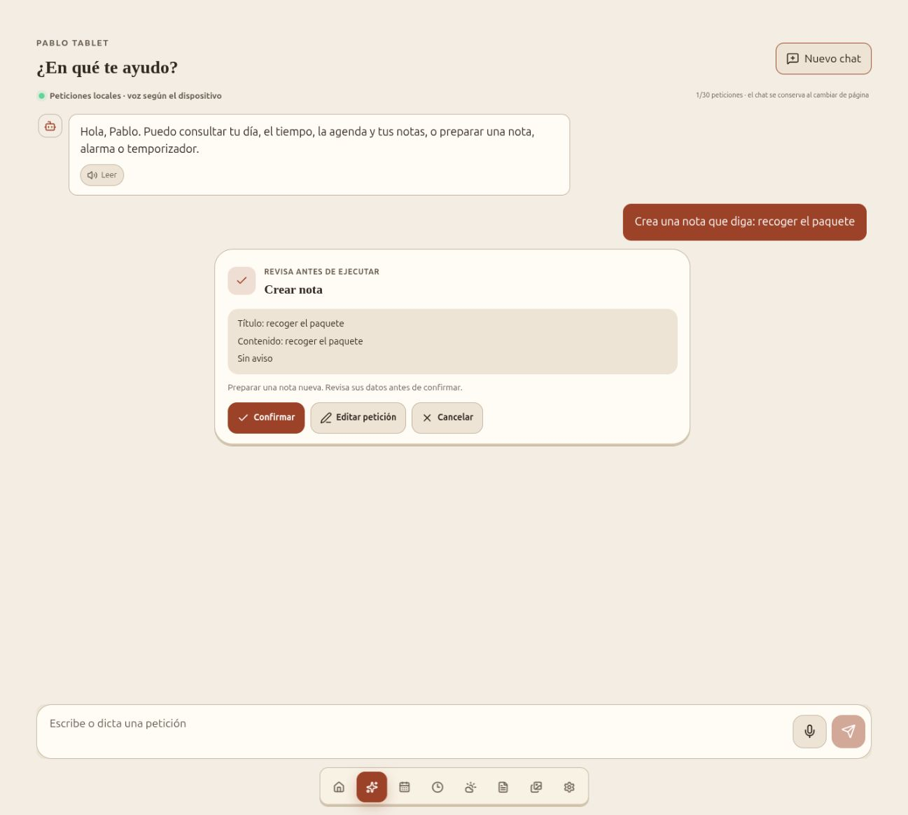
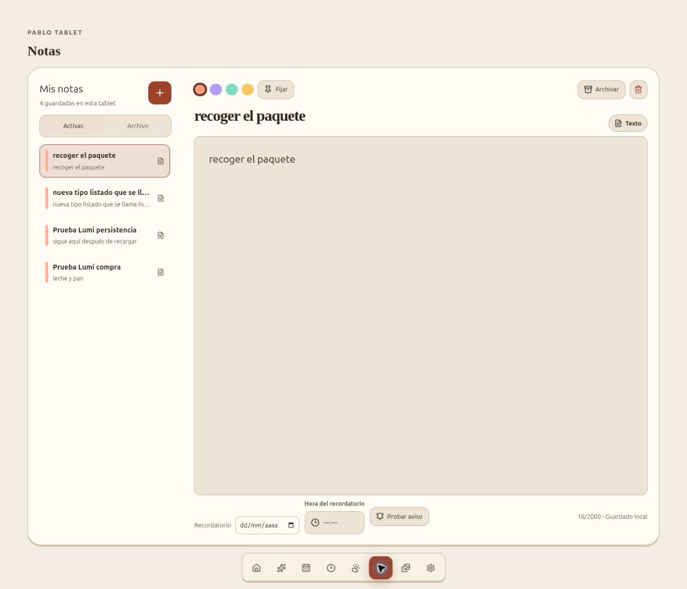
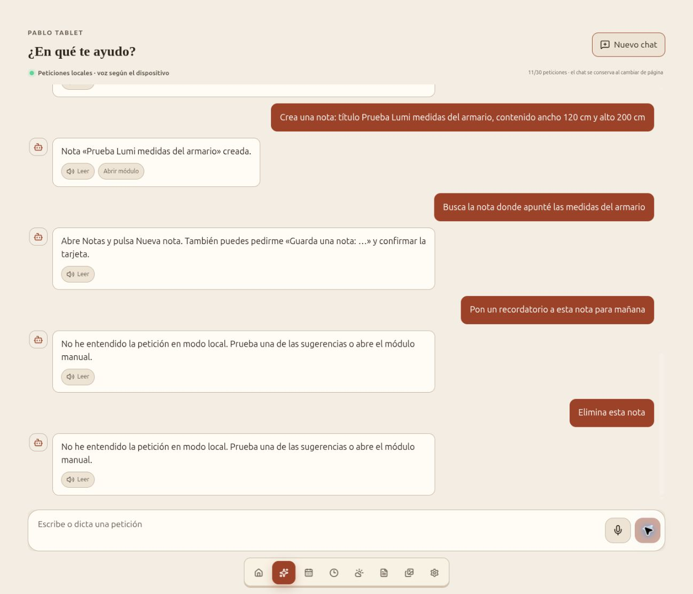
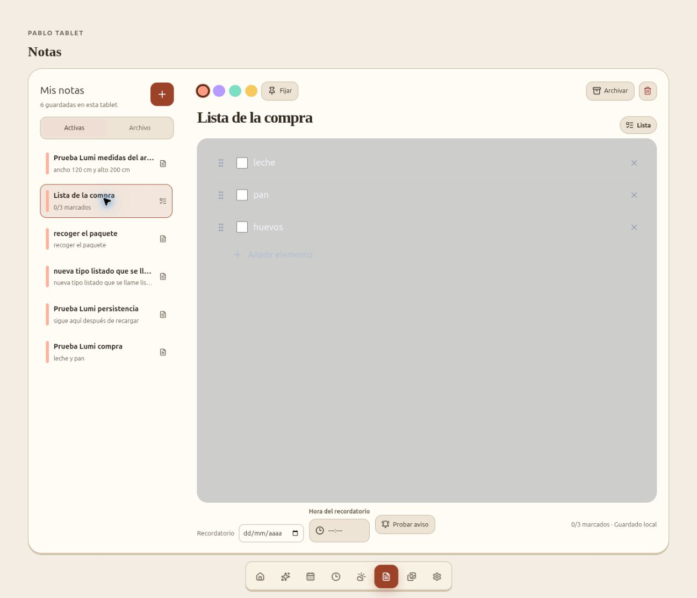
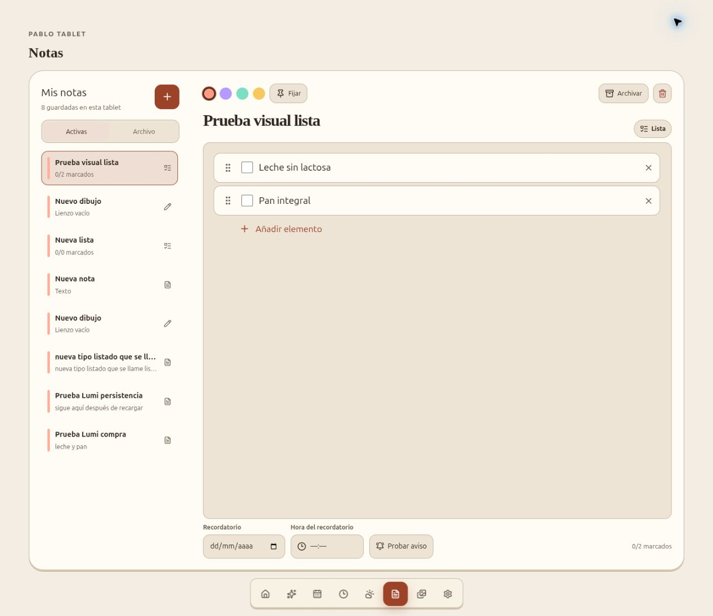

# Catálogo de peticiones de Lumi: comprobación por partes

Iniciado el 13/11/2026. Se prueba **un grupo completo por turno**, siguiendo el catálogo propuesto por el usuario. Por indicación del usuario, se termina el grupo y se espera su confirmación antes de comenzar el siguiente. No se desarrollan funciones nuevas como parte de estas comprobaciones sin acordarlo.

Entorno: Chrome, web local `http://localhost:5173/`, interacción escrita real desde el input de Lumi. Se usa una pestaña de prueba independiente. Este informe es distinto del de las pruebas generales; sus resultados no se extrapolan a voz o Android.

Estados: **correcta**, **parcial**, **fallo**, **no disponible** o **pendiente**. Un checkbox sin marcar significa que todavía no se ha probado, no que haya fallado. La marca de la web no implica validación de voz.

## Seguimiento — Notas y listas

- [x] 01. «Crea una nota que diga: recoger el paquete». **Correcta en web escrita.**
- [x] 02. «Crea una lista de la compra con leche, pan y huevos». **No disponible en el modo local actual.**
- [x] 03. «Añade pilas a la lista de la compra». **No disponible.**
- [x] 04. «Marca el pan como comprado». **Fallo: ayuda genérica en lugar de marcar.**
- [x] 05. «Quita los huevos de la lista». **No disponible.**
- [x] 06. «Cambia el título de esta nota a Compra semanal». **No disponible.**
- [x] 07. «Modifica la nota de la compra: cambia leche por leche sin lactosa». **No disponible.**
- [x] 08. «Léeme la lista de la compra». **No disponible.**
- [x] 09. «Busca la nota donde apunté las medidas del armario». **Fallo: instrucciones para crear en lugar de buscar.**
- [x] 10. «Pon un recordatorio a esta nota para mañana». **No disponible.**
- [x] 11. «Elimina esta nota». **No disponible.**

## Otros bloques del catálogo

Todavía no se han iniciado en esta revisión por partes:

- Calendario, tareas y cumpleaños.
- Alarmas y temporizadores.
- Aspecto y personalización.
- Pantalla de inicio y widgets.
- Fotos y salvapantallas.
- Sonido y controles del dispositivo, según capacidades Android.
- Lumi y seguimiento de la conversación.

Las comprobaciones generales anteriores se documentan en `91-pruebas-web-lumi-2026-11-13.md`; no sustituyen la revisión individual de las frases de este catálogo.

## 01 — Crear una nota sencilla

**Fecha:** 13/11/2026. **Resultado:** correcta en web escrita.

**Petición exacta:** «Crea una nota que diga: recoger el paquete».

**Esperado:** proponer una nota con el texto solicitado, pedir confirmación y guardar una sola nota únicamente después de confirmar.

**Observado:**

1. El estado inicial contiene tres notas activas. Ninguna corresponde a «recoger el paquete».
2. Al enviar la petición, Lumi muestra «Crear nota», con:
   - Título: recoger el paquete.
   - Contenido: recoger el paquete.
   - Sin aviso.
   - «Preparar una nota nueva. Revisa sus datos antes de confirmar».
3. Se visita Notas antes de confirmar: siguen existiendo tres notas y la nueva no aparece. Al volver a Asistencia, la propuesta sigue pendiente.
4. Se pulsa Confirmar. Respuesta exacta: **«Nota “recoger el paquete” creada.»** (la interfaz utiliza comillas angulares).
5. Notas pasa de tres a cuatro entradas. Existe una sola nota nueva «recoger el paquete», con título y contenido exactos, de tipo Texto, sin fecha ni hora de recordatorio.

**Interpretación:** comprende la fórmula «que diga» y elimina correctamente el prefijo de la orden. Como no se indica título, usa el mismo texto para título y contenido. No se observa creación anticipada ni duplicado.

**Datos conservados:** una nota de prueba cuyo título y contenido son «recoger el paquete». Las tres notas previas no se modifican. No se prueba borrado, lectura en voz alta ni persistencia tras recarga en este paso.

**Cambios de código:** ninguno. **Continuación:** completada junto con el resto del grupo; véase el resultado global más abajo.

## Resultado global del grupo Notas y listas

**Estado: revisión terminada, 11 de 11 frases comprobadas.** Solo 1 realiza la operación pedida: crear una nota de texto. Otras 8 no se reconocen y 2 se desvían a ayuda genérica o inadecuada. Los checks indican comprobación realizada; no equivalen a funciones implementadas.

Se prueban las frases exactas del catálogo, por escrito en Chrome. La petición 01 se conserva de la sesión anterior; en esta sesión se comprueban 02–11 y se prepara una nota adicional para la búsqueda. No se modifica código ni se ejecutan suites automatizadas.

### Preparación y condiciones

La sesión empieza con cuatro notas. La petición 02 falla sin crear nada. Para que las siguientes no dependan de una lista inexistente, se prepara **manualmente desde Notas** una nota de tipo Lista llamada «Lista de la compra», con leche, pan y huevos, todos sin marcar. No se presenta esta preparación manual como un éxito de Lumi.

Antes de 06, esa lista es la última nota abierta en el módulo. Durante la sesión, después de 08, se crea mediante la orden conocida «Crea una nota: título Prueba Lumi medidas del armario, contenido ancho 120 cm y alto 200 cm» y se confirma. Lumi responde «Nota «Prueba Lumi medidas del armario» creada». La búsqueda 09 dispone así de un resultado real. Antes de 10 y 11 se abre la nota de medidas en Notas y se vuelve a Asistencia; también es la última nota creada en la conversación. La referencia «esta nota» cuenta por tanto con un antecedente de prueba, aunque Lumi no resuelva ese contexto.

### Respuestas observadas por petición

Respuesta común **R**: «No he entendido la petición en modo local. Prueba una de las sugerencias o abre el módulo manual.»

| Nº | Petición exacta | Respuesta y efecto observado | Resultado |
|---|---|---|---|
| 02 | Crea una lista de la compra con leche, pan y huevos | R. No presenta propuesta ni crea la lista; se prepara después por los menús. | No disponible |
| 03 | Añade pilas a la lista de la compra | R. La lista existente sigue con tres elementos; no añade pilas. | No disponible |
| 04 | Marca el pan como comprado | «Puedo ayudarte con el resumen del día, tiempo, agenda, notas, alarmas, temporizadores y funciones básicas de la tablet.» No marca pan ni pregunta a qué lista se refiere. | Fallo de interpretación |
| 05 | Quita los huevos de la lista | R. Los huevos siguen en la lista. | No disponible |
| 06 | Cambia el título de esta nota a Compra semanal | R. El título continúa siendo «Lista de la compra». No pide aclarar la referencia. | No disponible |
| 07 | Modifica la nota de la compra: cambia leche por leche sin lactosa | R. El elemento sigue siendo «leche». | No disponible |
| 08 | Léeme la lista de la compra | R. No devuelve sus elementos; no se valida audio de voz en esta revisión escrita. | No disponible |
| 09 | Busca la nota donde apunté las medidas del armario | «Abre Notas y pulsa Nueva nota. También puedes pedirme “Guarda una nota: …” y confirmar la tarjeta.» La interfaz utiliza comillas angulares. Devuelve instrucciones para crear en lugar de encontrar la nota que sí existe. | Fallo de interpretación |
| 10 | Pon un recordatorio a esta nota para mañana | R. No solicita una hora ni muestra propuesta; la nota de medidas continúa sin fecha ni hora de aviso. | No disponible |
| 11 | Elimina esta nota | R. No solicita confirmación y no elimina la nota de prueba. No se pulsa Eliminar en el módulo para simular el resultado. | No disponible |

### Verificación final y datos conservados

- Notas contiene seis entradas: las cuatro iniciales más la lista preparada manualmente y la nota ficticia de medidas.
- La lista conserva el título «Lista de la compra», tres elementos leche/pan/huevos y contador **0/3 marcados**. No contiene pilas, no se ha sustituido leche y no se han quitado huevos.
- La nota de medidas mantiene «ancho 120 cm y alto 200 cm», sin recordatorio, y no se ha borrado.
- No se modifica ninguna nota previa ni se ejecuta otra operación al recibir respuestas de error o ayuda.
- La creación de listas y edición mediante los menús no implica que Lumi admita esas operaciones.

### Observación independiente del editor

Al preparar la lista se observaron pulsaciones de «Añadir elemento» sin un nuevo elemento inmediatamente visible después de editar. Se continuó con el teclado. Al intentar navegar con un campo enfocado, la interfaz mostró un modo de edición con «Terminar edición» y sin navegación; tras terminar la edición, se pudo continuar. Se registra como fricción observada del editor, sin atribuir una causa definitiva ni contabilizarla como fallo de comprensión de Lumi.

### Evidencias y siguiente grupo

- [Transcripción visible de la conversación](evidencias/lumi-catalogo/notas-listas-conversacion.txt).
- Captura de las respuestas y del estado final de la lista, debajo.
- **Siguiente grupo: Calendario, tareas y cumpleaños. No iniciado; se espera confirmación del usuario.**
- Voz, Android y disponibilidad de otros motores de lenguaje no se validan con estas pruebas.

## Corrección visual solicitada después del grupo — 13/11/2026

Antes de iniciar Calendario, el usuario solicita corregir el editor de listas, quitar «Guardado local» del pie y alinear el recordatorio. Se sustituyen las superficies, bordes y colores fijos por los tokens del tema activo, incluyendo filas, texto, casillas, controles de añadir/quitar/mover y estados de completado y reordenación. Se mantiene el contador de elementos marcados; también se quita «Guardado local» del contador de notas de texto.

El pie presenta las etiquetas de fecha/hora sobre sus controles. Fecha, hora y Probar aviso tienen 44 px de altura y alineación inferior compartida. Comprobación real en Chrome con el tema claro activo: los tres controles arrojan la misma posición superior 965,03, inferior 1009,02 y altura 43,99 px (redondeo de escala del navegador). La captura confirma texto legible y superficies acordes con el tema. No se cambia de tema durante esta revisión ni se da por validada otra variante visual.

Se crea una lista separada «Prueba visual lista», con «Leche sin lactosa» y «Pan integral», para no modificar las notas existentes del usuario. Se conserva como dato de prueba. Compilación web correcta; sin suites automatizadas ni actualización de Android. Estas correcciones visuales no añaden nuevas órdenes a Lumi y el grupo Calendario sigue sin iniciarse.

