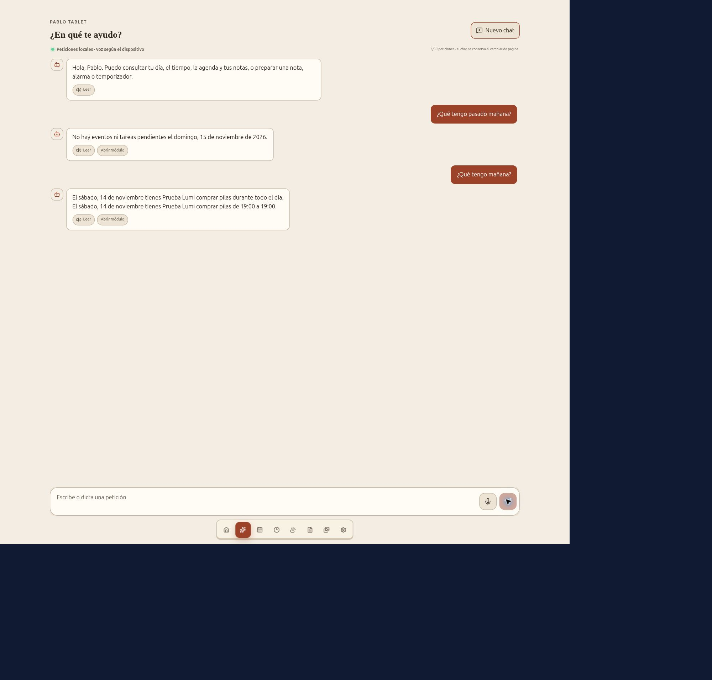
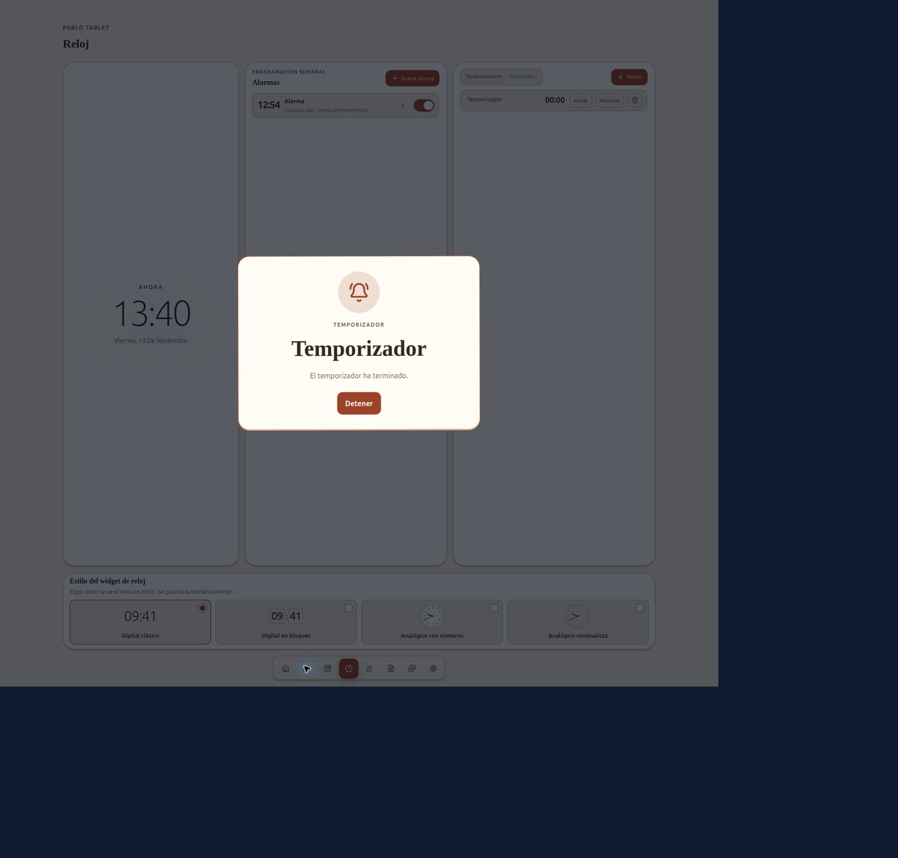
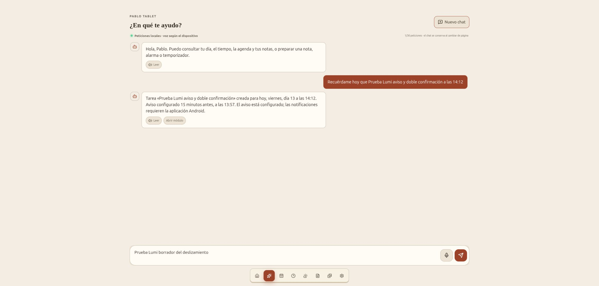
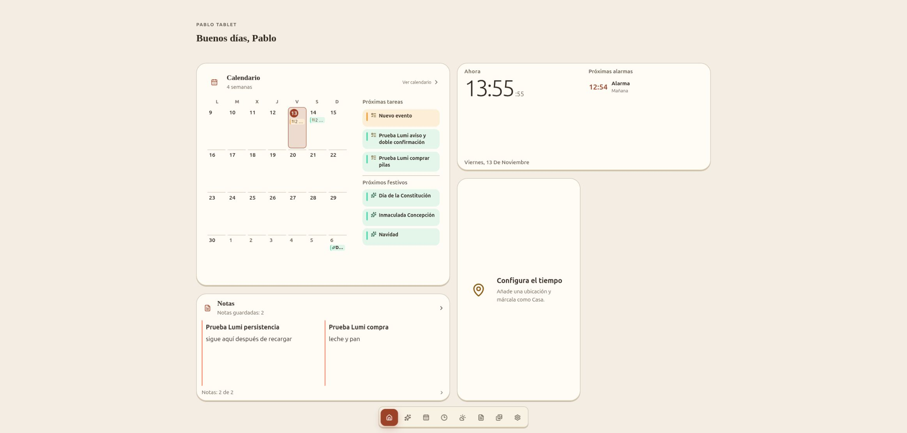
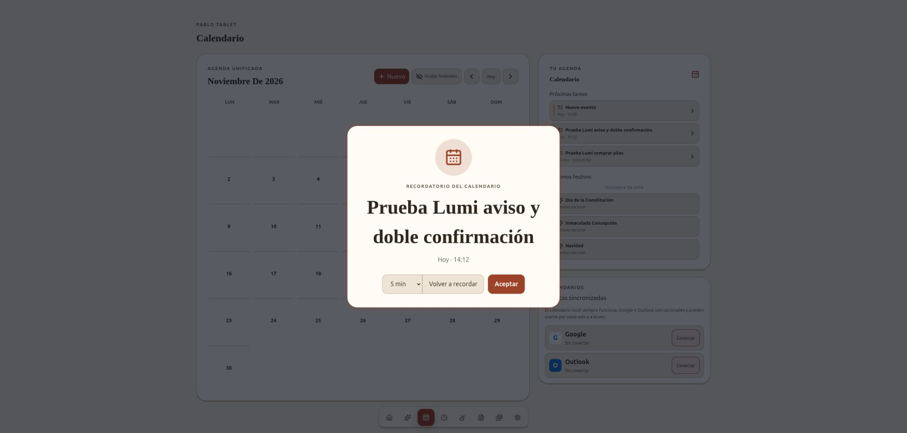

# Pruebas reales de Lumi en Chrome — 13/11/2026

Pruebas escritas en la interfaz de `http://localhost:5173/`, perfil Chrome Pablo, mediante la extensión. No se ejecutan suites automatizadas ni se modifica código durante esta revisión. Los resultados corresponden a esta sesión de navegador; no validan voz ni Android.

## Resultados

| Prueba | Resultado observado | Estado |
|---|---|---|
| Agenda y contexto | «¿Qué tengo mañana?» responde que no hay eventos ni tareas el sábado 14 de noviembre. «¿Y pasado mañana?» mantiene el contexto y responde sobre el domingo 15. Calendario no mostraba tareas esos días antes de las creaciones. | Correcta |
| Crear tarea | «Crea una tarea para mañana: Prueba Lumi comprar pilas» muestra título, fecha «mañana, sábado, día 14», todo el día sin aviso y destino local. Antes de confirmar no aparece en Calendario; tras confirmar aparece una vez y Lumi la encuentra al consultar mañana. | Correcta |
| Aclaración y cancelación | «Recuérdame mañana que vaya a comprar pilas» pregunta hora. «a las siete» pregunta mañana/tarde. «por la tarde» prepara las 19:00, aviso 1 hora antes y destino calendario local. Cancelar elimina la propuesta. Al revisar posteriormente Calendario no existe esta tarea cancelada. | Correcta |
| Hora al final y cambio de aviso | «Recuérdame mañana que vaya a Prueba Lumi comprar pilas a las siete de la tarde» reconoce título y 19:00 sin más preguntas. Cambiar el selector a 30 minutos actualiza la propuesta. Tras confirmar, el editor del evento muestra 07:00 PM y un recordatorio el 14 de noviembre a las 06:30 PM. | Correcta |
| Nota | «Crea una nota: título Prueba Lumi compra, contenido leche y pan» presenta título y contenido por separado. Tras confirmar, Notas muestra exactamente una nota con esos datos. | Correcta |
| Temporizador | «Pon un temporizador de un minuto» prepara duración 1 minuto y pide confirmación. Tras confirmar, Reloj muestra la cuenta atrás (se observó 00:19). Al terminar aparece el modal «El temporizador ha terminado», con colores y tipografía del tema claro activo. Se cierra mediante Detener. No se valida el audio. | Correcta |
| Navegación | Al salir de Asistencia con una propuesta pendiente y regresar, conserva conversación, contador y propuesta. Un borrador «Prueba Lumi borrador sin enviar» también sigue en el input tras visitar Notas y volver. Se utilizaron botones de navegación, no el gesto físico de deslizamiento. | Correcta para navegación con botones |
| Nuevo chat | Con la propuesta «Crea una tarea para pasado mañana: Prueba Lumi no guardar» pendiente, Nuevo chat deja solo el saludo y contador 0/30. Consultar pasado mañana confirma que no se creó. Las dos tareas confirmadas siguen en la consulta de mañana y la nota sigue en Notas. En una segunda comprobación, Nuevo chat también vacía el borrador sin enviar. | Correcta |
| Peticiones incompletas | «Crea una tarea» responde «Indica la fecha y el título. Ejemplo: “Crea una tarea para mañana: comprar pilas”». «Recuérdame comprar pan» responde «Indica el día y qué quieres recordar…». No muestran propuestas de ejecución. | Correcta |
| Redacción de tarea con hora | Al consultar mañana después de crear las dos tareas, dice «Prueba Lumi comprar pilas de 19:00 a 19:00». Los datos guardados son coherentes con el editor, pero la respuesta debería decir «a las 19:00» cuando inicio y fin coinciden. | Mejora pendiente |

## Hallazgo reproducible

1. Solicitar «Recuérdame mañana que vaya a Prueba Lumi comprar pilas a las siete de la tarde».
2. Confirmar la propuesta.
3. Preguntar «¿Qué tengo mañana?».
4. Observar «El sábado, 14 de noviembre tienes Prueba Lumi comprar pilas de 19:00 a 19:00».

Prioridad baja: redacción de la consulta; no se observa una pérdida de datos ni ejecución sin confirmar. No se ha corregido durante esta prueba.

## Datos de prueba conservados

- Dos tareas locales «Prueba Lumi comprar pilas» el 14/11/2026: una de todo el día sin aviso y otra a las 19:00 con aviso a las 18:30. Son dos creaciones deliberadas, no un duplicado inesperado.
- Una nota «Prueba Lumi compra» con contenido «leche y pan».
- Un temporizador «Temporizador» de un minuto, terminado y detenido.

No se borra ni modifica la alarma o tarea que ya existían. La web queda en Asistencia con un chat nuevo vacío. No se recarga la página ni se valida persistencia tras cerrar/reabrir; tampoco se prueban micrófono, síntesis de voz, avisos nativos, segundo plano o pantalla bloqueada.

## Segunda sesión: cuatro comprobaciones adicionales

Realizada el mismo 13/11/2026, aproximadamente entre las 13:53 y las 14:00, hora de Madrid. Se abre una pestaña independiente en el mismo origen `http://localhost:5173/` para conservar la conversación y propuesta que el usuario había dejado abiertas en la pestaña original. Las limitaciones sobre recarga y navegación con botones de la primera sesión quedan ampliadas por las siguientes pruebas reales.

### 1. Deslizar entre páginas — correcta

Tras crear la tarea de esta sesión, se escribe el borrador «Prueba Lumi borrador del deslizamiento». Se arrastra horizontalmente desde Asistencia hacia Calendario y después en sentido inverso para volver. La interfaz cambia efectivamente de página en ambos sentidos. Al regresar, conserva el mensaje enviado, la respuesta, el contador 1/30 y el texto exacto del borrador. Son gestos de arrastre con puntero en Chrome; no se valida el gesto táctil físico de Android.

### 2. Doble confirmación — correcta

Petición: «Recuérdame hoy que Prueba Lumi aviso y doble confirmación a las 14:12». Se cambia la antelación a 15 minutos y se realiza una doble pulsación rápida sobre Confirmar mediante `clickCount: 2` de la interacción real del navegador.

Lumi muestra una sola confirmación de creación. Calendario muestra exactamente una entrada con ese título; el día 13 pasa de una tarea previa a dos tareas totales. La consulta de elementos por título encuentra una sola coincidencia. Después de recargar, sigue existiendo una sola entrada. No se ha probado una carrera entre dos pestañas o dos dispositivos.

### 3. Persistencia tras recargar — correcta

Además de la tarea anterior, se crea y confirma «Crea una nota: título Prueba Lumi persistencia, contenido sigue aquí después de recargar».

Se recarga completamente la pestaña mediante la función normal de recarga del navegador. Inicio muestra la tarea y la nota, con su contenido intacto. Al abrir de nuevo la tarea en Calendario, mantiene el tipo Tarea, fecha 13/11/2026, hora 02:12 PM y un recordatorio a las 01:57 PM. El chat vuelve al saludo, input vacío y contador 0/30: no se da por implementada la persistencia del historial.

### 4. Aviso real de calendario con web abierta — correcta

Se utiliza el aviso de la tarea anterior, configurado para el 13/11/2026 a las 13:57, quince minutos antes de las 14:12. Se deja la app visible, después de haber recargado y comprobado el recordatorio.

Al vencer el aviso aparece el modal «RECORDATORIO DEL CALENDARIO», con el título «Prueba Lumi aviso y doble confirmación», referencia «Hoy · 14:12», selector de repetición, Volver a recordar y Aceptar. La app abre Calendario automáticamente. Se observa el tema claro activo en la superficie, texto, tipografía y botones.

Se registra una primera captura a las 13:57:26 (Madrid). Sin tocarlo, el modal sigue abierto 64 segundos después. Se pulsa Aceptar: desaparece. A los 58 segundos de aceptarlo no ha reaparecido; tampoco lo hace al navegar después a Inicio. Esta ventana de observación no equivale a garantizar su comportamiento indefinidamente, ni tras una segunda recarga después de aceptar.

Detalle de texto detectado: al crear el aviso, Lumi dice «las notificaciones requieren la aplicación Android», aunque el modal interno sí funciona en web abierta. Conviene distinguir el aviso interno de las notificaciones nativas del sistema. No se cambia código en esta sesión.

### Datos adicionales conservados y límites

- Una tarea «Prueba Lumi aviso y doble confirmación», el 13/11/2026 a las 14:12, con aviso a las 13:57 ya aceptado.
- Una nota «Prueba Lumi persistencia», contenido «sigue aquí después de recargar».
- Se mantienen los datos de la primera sesión. No se cancela ni confirma la propuesta que el usuario tenía en su pestaña original.
- Estas pruebas no validan voz, Android, segundo plano, pantalla bloqueada, repetición mediante Volver a recordar ni otro tema visual. No se ejecutan suites automatizadas ni se instala una APK.
